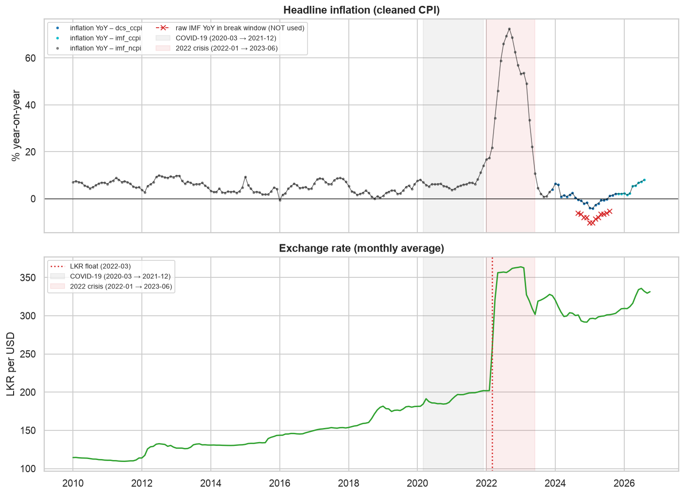
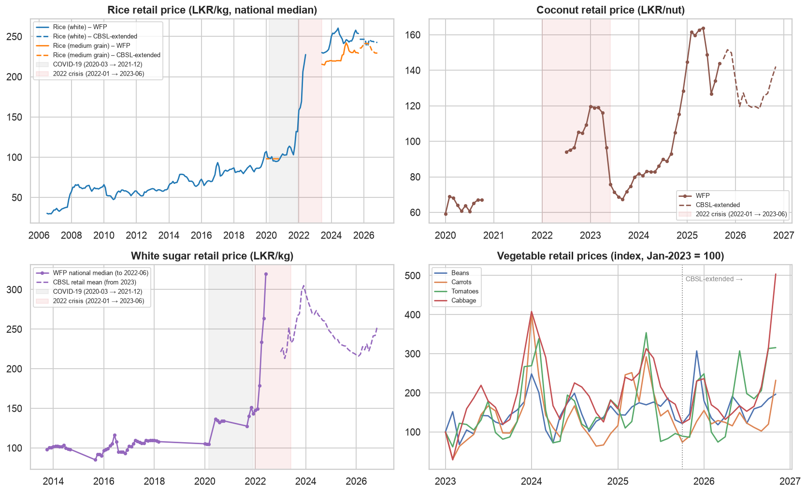
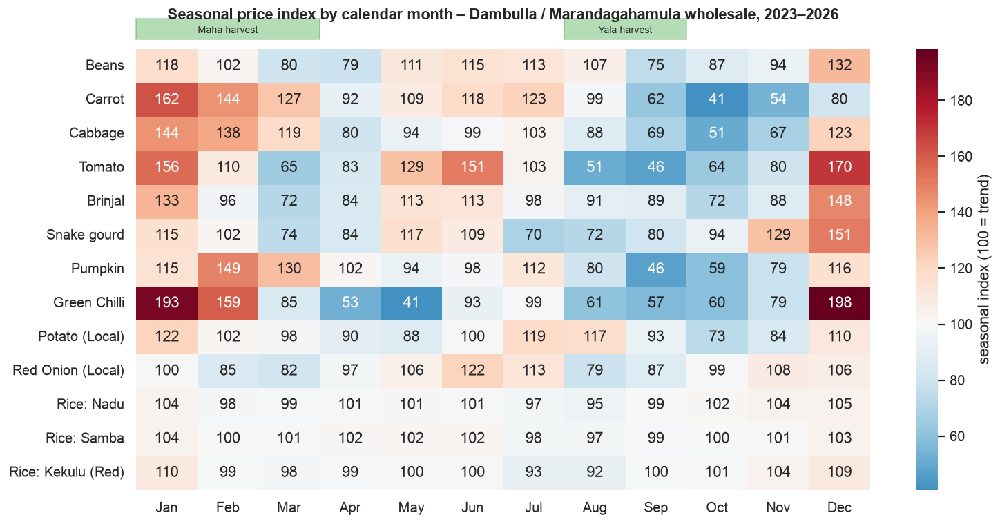
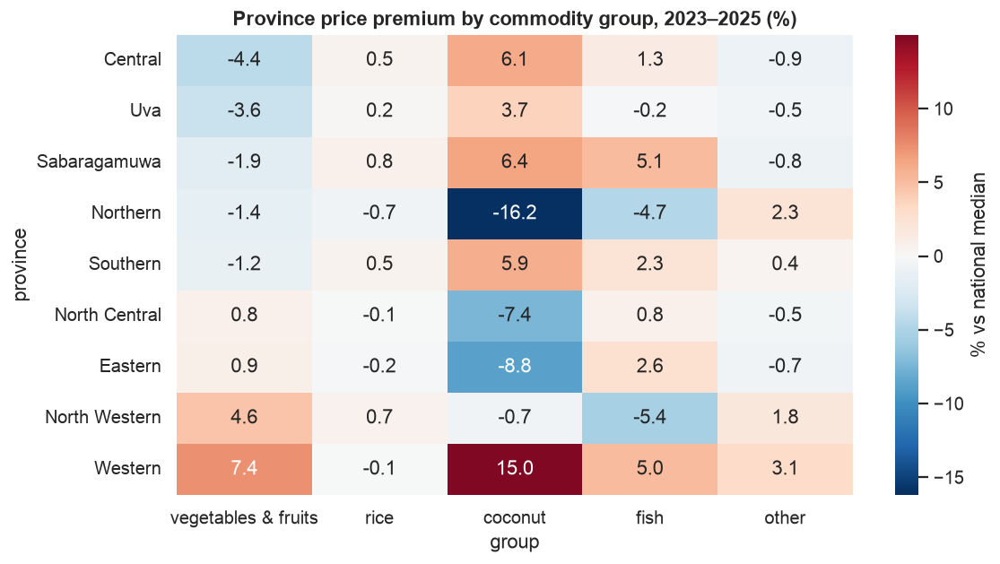
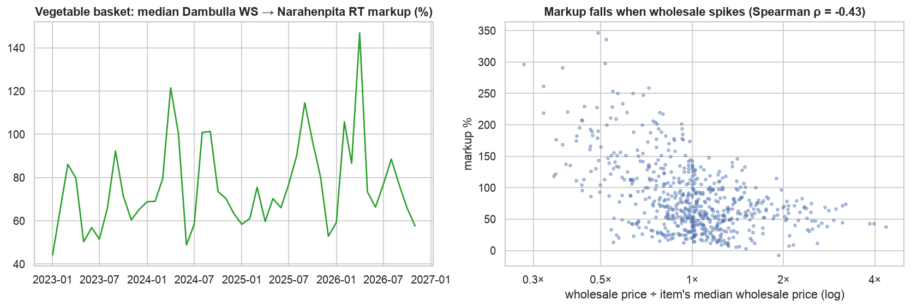

# Phase 2 – EDA, Regional Comparison & Project Setup

Branch: `feat/phase2-eda-and-regional`, based on `main` after Phase 1 (PR #1) was merged.

## What was added

| Path | What it is |
|---|---|
| `requirements.txt` | Packages for the pipeline, EDA, time series/econometrics (statsmodels), ML/anomaly detection (scikit-learn, LightGBM), dashboard (Streamlit) and notebooks |
| `notebooks/01_eda.ipynb` | Executed EDA notebook: macro trends, commodity trends, seasonality, 2022 crisis, regional comparison, wholesale–retail margins |
| `reports/figures/*.png` | The 13 figures from the notebook, for use in reports and the README |

LightGBM was chosen over Prophet: it is already installed, has no compiler/Stan dependency, and fits the lag-feature forecasting planned for Phase 4. Statsmodels covers SARIMA/SARIMAX and STL.

To rerun the notebook:

```bash
pip install -r requirements.txt
jupyter nbconvert --to notebook --execute --inplace notebooks/01_eda.ipynb
```

## Phase 1 caveats respected in the notebook
- **Inflation:** uses the cleaned `inflation_yoy_pct` and `cpi_headline_index`. The chart colours each month by `inflation_source` and shows the raw IMF values in the `cpi_break_flag` window as "not used".
- **Commodity prices:** come from `commodity_prices_continuous_monthly.csv`. WFP and CBSL-extended segments are drawn differently. Five items (pumpkin, bananas, local red onion, dried katta and sprats) end in 2025-09 because they failed the agreement test.
- **Sugar:** WFP sugar ends 2022-06, so it is shown next to the CBSL retail series, not joined to it.
- **Fuel:** months flagged `possible_missing_revision` are listed and left out of the analysis.
- **Monthly comparisons:** price changes compare 12-month averages, not single months, so seasonality doesn't distort them. 2026-11 is a partial month.

## Key findings

### Macro
- **Inflation:** peaked at **72.5% (Sep-2022)** and reached an official low of **−4.2% (Feb-2025)**. It was back at **8.0% by Aug-2026** and has been rising since Mar-2026, when fuel prices surged. That timing is noted but not tested as a cause.
- **LKR/USD:** went from **202 → 364 (Jan-2023, +80%)**. At **331 (Oct-2026)** it is only 9% below the peak.



### Commodity trends
| Item | 2023 avg | Last 12 m avg | Change | Volatility (max/min since 2023) |
|---|---|---|---|---|
| Rice (white) | 232 | 244 | +5% | 1.14 |
| Coconut (per nut) | 90 | 128 | +42% | 2.43 |
| Tomatoes | 309 | 512 | +66% | 5.72 |
| Beans | 455 | 617 | +36% | 4.55 |
| Cabbage | 263 | 362 | +38% | 17.6 |
| Lentils | 330 | 273 | −17% | 1.47 |
| Eggs (each) | 50 | 39 | −22% | 2.06 |

- **Rice:** roughly 2.5× its Jan-2021 level at the peak (Jun-2024), and flat since 2023. Its real price is unchanged (+1%).
- **Coconut:** the biggest post-crisis staple shock, from 67 → 164 LKR/nut (late 2023 → Apr-2025). Still **+40% in real terms** vs 2023.
- **Data point to check:** the WFP cabbage value for 2023-02 (48 LKR/kg, between 168 and 161) looks like a data error. It is a ready test case for anomaly detection.



### Seasonality (Maha / Yala)
Dambulla wholesale prices, used as a farm-gate proxy, 2023–2026. This is about 4 years of data, so the patterns are indicative.
- **Vegetable peak:** **Dec–Jan**, during the northeast monsoon and before the Maha harvest arrives. Tomato 170, green chilli 198, carrot 162 and cabbage 144 (trend = 100).
- **Vegetable trough:** **Sep–Oct**, after the Yala harvest. Carrot 41, cabbage 51, tomato 46.
- **Share of variation:** seasonality accounts for ~55% of the variance in beans' log price (STL).
- **Rice:** almost flat (±5–10%), highest in Dec–Jan and lowest in August.



### 2022 crisis
- **Wheat flour:** roughly tripled by Jun-2022, when the WFP series ends.
- **Rice:** kept climbing after the crisis window and peaked in mid-2024.
- **In USD terms:** local rice went from 0.57 → 0.86 USD/kg (2021 → 2024) while world rice went from 0.46 → 0.61. The gap between local and world prices widened.

### Regional comparison (38 WFP markets, 2023-01 → 2025-09)
- **Most expensive:** Western Province (vegetables +7.4%, coconut +15% vs national median). **Colombo City +7.7%**, Gampaha +7.2%.
- **Cheapest:** **Jaffna −9.7%**, plus up-country producing areas (Hanguranketha −8.8%, Keppetipola −4.7%). This looks like a producer-area discount.
- **Coconut:** over 30 points between Northern (−16%) and Western (+15%).
- **Median Western premium:** **+4%** across commodities.
- **Market integration:** **rice is nationally integrated** (all provinces within ±1%, cross-market CV ~5%). **Vegetables are not** (CV ~42%).



### Wholesale → retail margins (CBSL daily reports, 2023–2026)
| Markup (median) | Vegetables | Fruit | Coconut | Rice |
|---|---|---|---|---|
| Pettah retail / Pettah wholesale | 20% | 26% | 25% | 7% |
| Dambulla retail / Dambulla wholesale | 12% | 19% | 5% | – |
| **Narahenpita retail / Dambulla wholesale** | **69%** | **129%** | **48%** | – |

- **Biggest margin:** most of the farm-to-consumer margin builds up between the up-country hub and the Colombo consumer, not inside a single market.
- **Retail prices are sticky:** the markup falls when wholesale prices spike (Spearman ρ = −0.43). When wholesale prices crash, retail prices lag and margins widen.



## Implications for the next phases
- **Forecasting (Phase 4):** model **log prices** with month-of-year seasonality, crisis/float dummies and `inflation_source` awareness. Rice suits simple models; vegetables need seasonal terms.
- **Relationships (Phase 3):** test pass-through from LKR/USD and world prices for coconut, sugar and imported onion/potato. The widening local–world rice gap is worth a closer look.
- **Anomalies (Phase 5):** test cases are cabbage 2023-02 (likely a data error) and the Nov-2026 cabbage spike (likely real). The markup asymmetry also suggests flagging *retail* prices that fail to follow wholesale prices down.
