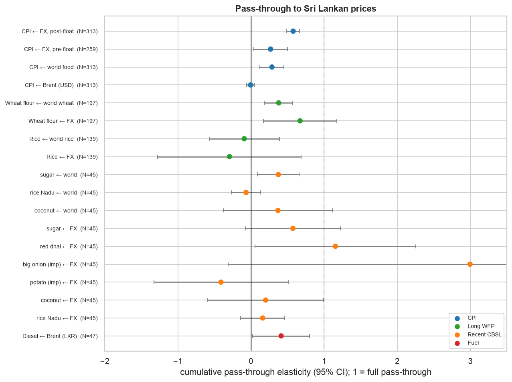
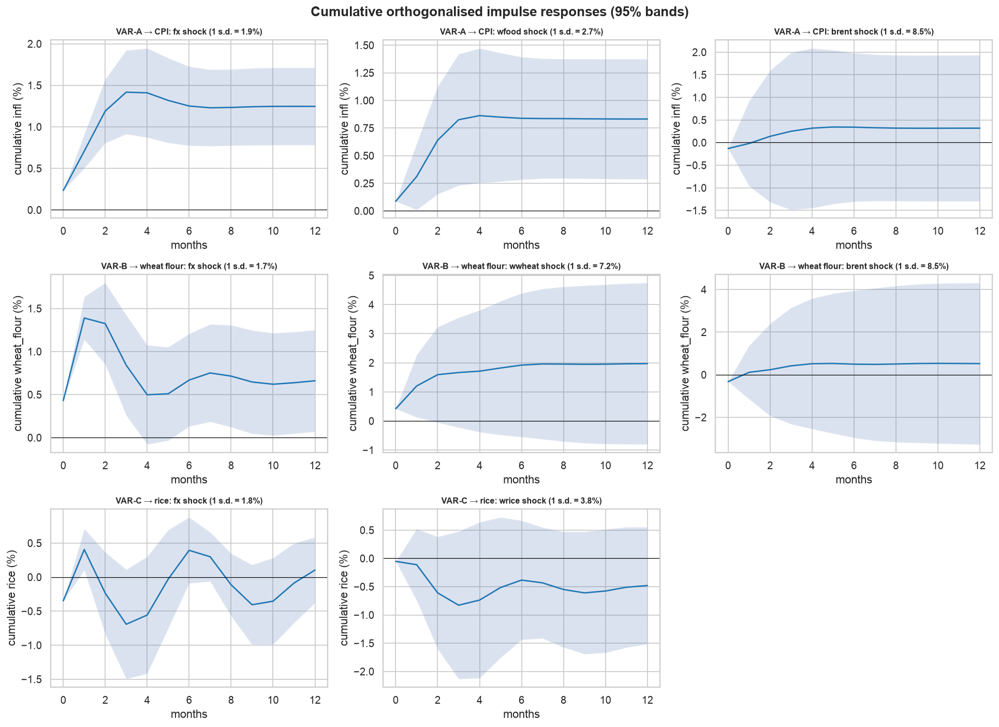

# Phase 3 – Economic Relationship Analysis

Branch: `feat/phase3-relationships`, based on `main` after Phase 2 (PR #2) was merged.

## What was added

| Path | What it is |
|---|---|
| `src/relationships.py` | Reusable analysis code: monthly dataset builder, coverage report, lead/lag correlations, ADF/KPSS, VAR (lag selection, diagnostics, Granger tests), distributed-lag pass-through with HAC SEs, Engle-Granger long-run test |
| `notebooks/02_relationships.ipynb` | Executed analysis notebook (no errors) |
| `reports/figures/14–18_*.png` | Lead/lag heatmaps, Granger p-values, impulse responses, pass-through forest plot |
| `reports/tables/phase3_*.csv` | Pass-through summary, VAR Granger tests, IRF summary, recent-sample Granger tests |

Supporting changes:
- **`scripts/08_build_fuel_prices.py`:**
  - DCS item names split by PDF extraction (`Petrol (C PC & IOC)`, `Gas- Avg.`) are now matched.
  - Each release's *previous-month* price column fills months whose own release couldn't be parsed. It agrees with the current-month values within 1.25 LKR where both exist.
  - Result: diesel/petrol 2023–26 coverage rises from 22 to 27 DCS months.
- **`requirements.txt`:** `statsmodels>=0.14.5`. Older statsmodels fails to import `statsmodels.api` with SciPy ≥ 1.16. `src/relationships.py` imports submodules directly, so it also works on the older version.

## Method
- **Transformations:** monthly **100 × log-changes**. All levels are non-stationary (ADF/KPSS), and all changes are stationary, so coefficients are elasticities.
- **Inflation:** the cleaned CPI (`inflation_mom_pct`), never the raw IMF series. `ccpi_basis` controls for the NCPI → CCPI basis change, and the `cpi_break_flag` months use official DCS values. A robustness run on the NCPI-only sample (to 2023-11) gives the same answers.
- **Regime controls:** `covid` (2020-03 → 2021-12), `crisis` (2022-01 → 2023-06), and `post_float` (from 2022-03, used as an interaction with FX).
- **VARs:** the lag is chosen by AIC (BIC/HQIC also reported). Ordering is world → FX → domestic (Cholesky). Regime dummies enter as exogenous variables. Cumulative orthogonalised IRFs have asymptotic 95% bands.
- **Pass-through:** distributed lags 0–6 (long samples) or 0–3 (recent sample), with Newey-West SEs. Cumulative pass-through is the sum of the lag coefficients, tested jointly.

## Samples and data limits

| Sample | Period | N (monthly changes) | Used for |
|---|---|---|---|
| A – macro | 2000-02 → 2026-08 | 313–318 | CPI, LKR/USD, Brent, world food |
| B – long WFP | 2006-02 → 2022-06 (rice 2010-06 →) | 139–197 | wheat flour, white rice |
| C – recent CBSL | 2023-02 → 2026-10 | 45 | sugar, dhal, big onion, potato, coconut, Nadu rice |
| Fuel (pooled) | 2015-10 → 2018-03 + 2023 → 2026 | 47–48 | retail diesel vs Brent-in-LKR |

**Truncated or missing series**
- **Wheat flour:** ends 2022-06, at the crisis peak.
- **Sugar:** WFP sugar is 61 scattered months ending 2022-06, and CBSL sugar starts 2023-01. They **never overlap**, so the CBSL series is used alone.
- **WFP lentils, onion, coconut:** have 2021–22 gaps, so the CBSL versions are used instead.
- **World rice benchmark:** starts 2010-05.
- **Fuel:** too gappy for a VAR (diesel 48 changes over two periods), so Brent-in-LKR is the fuel-cost variable in the VARs. Months flagged `possible_missing_revision` are excluded.
- **Interest rates:** stop in 2020-05 and are not used.

## Findings

| Relationship | Cumulative elasticity | p | N |
|---|---|---|---|
| **CPI ← LKR/USD, post-float (0–6 m)** | **0.58** | <0.001 | 313 |
| CPI ← LKR/USD, pre-float | 0.27 | 0.02 | 259 |
| CPI ← world food index | 0.29 | 0.001 | 313 |
| CPI ← Brent (USD) | ≈0 | 0.84 | 313 |
| Wheat flour ← world wheat | 0.38 | <0.001 | 197 |
| Wheat flour ← LKR/USD | 0.67 | 0.009 | 197 |
| Rice ← world rice / LKR/USD | ≈0 (n.s.) | 0.7 / 0.6 | 139 |
| Sugar ← world sugar (0–3 m) | 0.37 | 0.01 | 45 |
| Sugar ← LKR/USD | 0.57 | 0.09 | 45 |
| Red dhal ← LKR/USD | 1.15 | 0.04 | 45 |
| Big onion (imp) ← LKR/USD | 3.0 | 0.08 | 45 |
| Coconut, imported potato, Nadu rice ← FX/world | n.s. | >0.3 | 45 |
| Retail diesel ← Brent in LKR (0–2 m) | 0.41 | 0.04 | 47 |

1. **The exchange rate is the main driver of Sri Lankan inflation**, and pass-through roughly **doubled after the 2022 float**, from 0.27 to 0.58 within six months.
   - **Timing:** FX moves lead CPI by 1–2 months (r = 0.51 at lag 1).
   - **VAR-A:** FX Granger-causes CPI (p < 0.001), and a 1.9% depreciation shock raises the price level ≈1.25% within a year.
2. **World food prices pass through to CPI (≈0.29); world oil does not directly (≈0).** Domestic fuel prices are administered, so oil reaches consumers through **retail fuel price revisions**. Diesel follows Brent-in-LKR with a **one-month lag** (r = 0.74 in 2023–26), consistent with a monthly pricing formula.
3. **Imported wheat flour transmits both channels:** world wheat (0.38) and FX (0.67).
4. **Rice is insulated from world prices and the exchange rate.** There is no significant pass-through in either sample and no cointegration with import parity, consistent with Phase 2's widening local–world rice gap. The VAR-C Granger result (FX ↔ rice, both directions) reflects 2022 co-movement, not stable pass-through.
5. **Recent import-dependent staples:**
   - **Sugar** tracks world sugar.
   - **Dhal** and **imported big onion** respond to the exchange rate, with dhal also linked to fuel costs.
   - **Coconut** (a domestic crop) and imported potato show no external pass-through.

## Caveats
- **Low power in the recent sample:** 45 months. Best-lag correlations are chosen after the fact across 7 lags, so isolated "significant" results (e.g. negative FX correlations at lag 6 for sugar and Nadu rice) are probably false positives.
- **Residual diagnostics:**
  - VAR-A residuals fail the whiteness test (lag 2, and also at BIC's lag 1).
  - VAR-B/C pass whiteness (p ≈ 0.30), but all residuals are non-normal because of crisis outliers.
  - Impulse-response bands are therefore approximate.
- **Granger causality is predictive timing, not causation.** Reverse results such as "wheat flour → world wheat" (p = 0.003) or "world food → Brent" reflect common shocks, e.g. the 2022 global price spike coinciding with Sri Lanka's crisis.
- **Engle-Granger tests** don't find cointegration for wheat flour or rice against import parity in levels (p = 0.23 / 0.85). Long-run level elasticities (0.65 / 0.91) are therefore descriptive only.

## Implications for Phase 4 (forecasting) and Phase 5 (anomalies)
- **Forecasting features:**
  - **CPI:** include lagged LKR/USD (1–3 months) and world food prices, with a post-float regime flag.
  - **Diesel:** include lagged Brent-in-LKR (1 month).
  - **Wheat flour and sugar:** world benchmarks.
  - **Rice:** use own-history/seasonal models. External drivers add little.
- **Anomaly detection:** an FX- or world-price-adjusted expected price (from these elasticities) gives a baseline. Deviations from it are more informative than raw price jumps.
