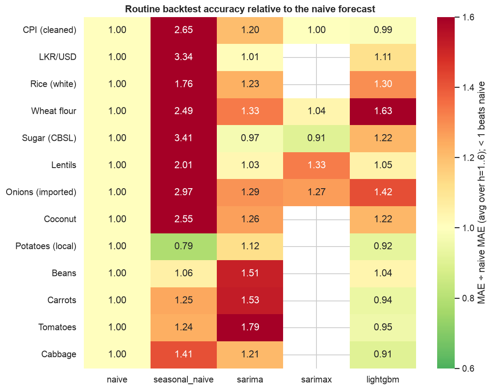
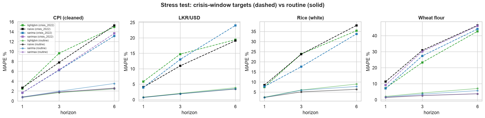
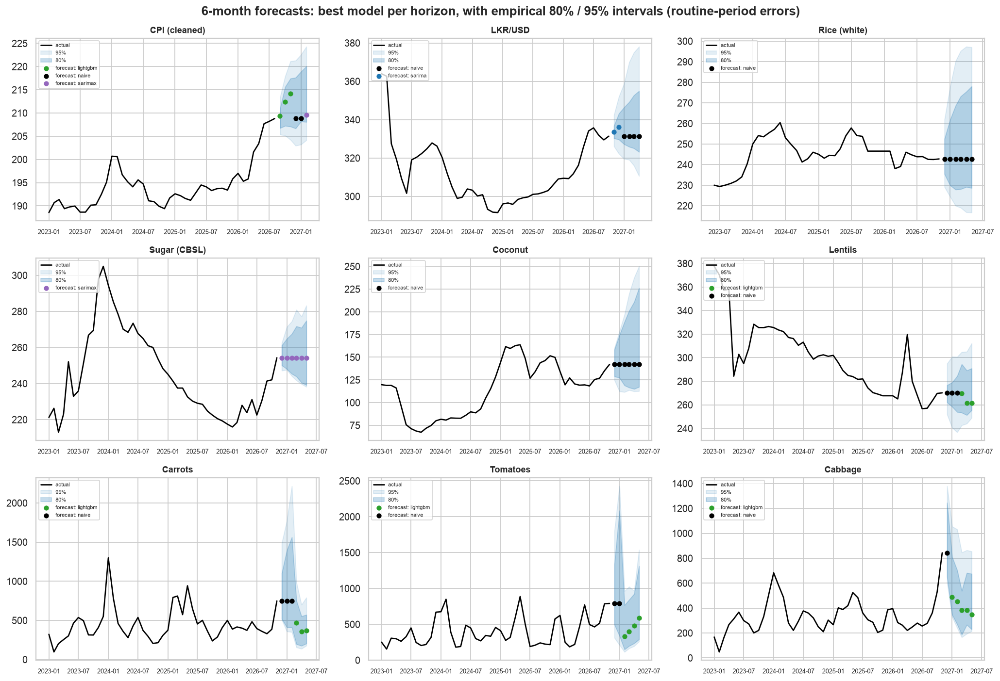

# Phase 4 – Price Forecasting

Branch: `feat/phase4-forecasting`, based on `main` after Phase 3 (PR #3) was merged.

## What was added

| Path | What it is |
|---|---|
| `src/forecasting.py` | Series selection, leakage-safe driver handling, naive / seasonal naive / SARIMA / SARIMAX / LightGBM forecasters, rolling-origin backtest, scoring (MAE, RMSE, MAPE, MAE vs naive), per-horizon model selection, empirical prediction intervals |
| `scripts/09_forecast_backtest.py` | Runs all backtests and final forecasts (~4 min) and writes `reports/tables/phase4_*.csv` |
| `scripts/10_lstm_experiment.py` | Optional LSTM check on CPI and rice (PyTorch) |
| `notebooks/03_forecasting.ipynb` | Executed notebook: selection, routine accuracy, crisis stress test, LSTM check, 6-month forecasts |
| `reports/figures/19–23_*.png` | Relative-MAE heatmap, MAPE by horizon, stress test, CPI backtest path, forecast panel |
| `reports/tables/phase4_*.csv` | Backtest forecasts (24,777 rows), scores, best models, model specs, forecasts, selected forecasts, LSTM check |

Rerun:

```bash
python3 scripts/09_forecast_backtest.py
python3 scripts/10_lstm_experiment.py      # optional, needs torch
jupyter nbconvert --to notebook --execute --inplace notebooks/03_forecasting.ipynb
```

`statsmodels` is imported submodule by submodule (as in Phase 3), so the code runs with the installed statsmodels 0.14.2 + SciPy 1.17. `requirements.txt` asks for ≥ 0.14.5.

## 1. Series selection

| Group | Series | History | Backtest origins | Notes |
|---|---|---|---|---|
| Long | CPI (cleaned) | 2000-01 → 2026-08 | 199 (from 2010-01) | SARIMAX drivers: LKR/USD, world food |
| Long | LKR/USD | 2000-01 → 2026-10 | 201 | macro driver; no external drivers |
| Long | White rice | 2006-07 → 2026-11 | 174 | gap 2022-07 → 2023-05 kept missing; no validated drivers → no SARIMAX |
| Long | Wheat flour | 2006-01 → 2022-06 | 138 | **backtest/stress test only** (series ended) |
| Recent | Coconut, beans, carrots, tomatoes, cabbage, local potato | 2022-07 → 2026-11 | 29 | no validated drivers |
| Recent | Imported onion, lentils | 2022-07 → 2026-11 | 29 | SARIMAX driver: LKR/USD |
| Recent | Sugar (CBSL retail) | 2023-01 → 2026-11 | 23 | SARIMAX drivers: world sugar, LKR/USD |

- **Short series:** recent items have only ~47–53 months, so LightGBM is **pooled** across the nine items with an item feature. They can't be stress-tested on 2022, because their histories begin in or after it.
- **Not forecast:** retail fuel (gappy, administered, flagged months) and items Phase 2/3 couldn't extend past 2025-09 (pumpkin, bananas, local red onion, dried fish).
- **Partial month:** the last observation for the recent items, 2026-11, covers CBSL reports only to 2026-11-25.

## 2. Leakage guardrails
- **Information cut-off:** every forecast at origin *t* uses data dated ≤ *t*. LightGBM trains only on rows whose target month is ≤ *t*.
- **Drivers:** enter **lagged ≥ 1 month**. Future driver values not yet known at the information date are **held at the last observed value** (random walk), never filled with actuals.
  - In backtests, the information date is the origin.
  - For the final forecast, it's each driver's real last observation. For example, LKR/USD for Sep–Oct 2026 is known when CPI ends in Aug-2026, and is used.
- **Model orders:** SARIMA/SARIMAX orders are chosen by AIC on the **initial training window only**, then kept fixed.
- **Fuel:** months flagged `possible_missing_revision` are never used, and fuel is not a model input.
- **Gaps:** target gaps are not imputed (the state-space model handles NaNs), and no forecast is scored against a missing actual.

## 3. Evaluation design
- **Backtest:** rolling origin, refit at every monthly origin, horizons 1–6.
- **Metrics:** MAE, RMSE (LKR / index points), MAPE (%) with a guard against near-zero actuals, and **MAE ÷ naive MAE**.
- **Crisis split:** forecasts whose **target month** falls in **2022-01 → 2023-06** are scored separately as the **crisis stress test** and kept out of routine scores.
- **Model selection:** best model **per series and horizon** by routine MAE.
- **Prediction intervals:** **empirical** 80%/95% intervals from each model's own routine backtest errors at that horizon. They describe normal-times uncertainty.

## 4. Results



**Routine accuracy (best model MAE ÷ naive MAE by horizon):**

| Series | h1 | h3 | h6 | Best models |
|---|---|---|---|---|
| CPI (cleaned) | **0.88** | 0.97 | 0.99 | LightGBM (h1–3), naive/SARIMAX (h4–6) |
| LKR/USD | 0.94 | 1.00 | 1.00 | SARIMA (h1–2), then naive |
| White rice | 1.00 | 1.00 | 1.00 | naive |
| Wheat flour | 1.00 | 1.00 | 1.00 | naive |
| Sugar (CBSL) | **0.80** | 0.90 | 0.96 | SARIMAX (all horizons) |
| Lentils | 1.00 | 1.00 | 0.89 | naive, then LightGBM (h4–6) |
| Imported onion | 1.00 | 1.00 | 1.00 | naive |
| Coconut | 1.00 | 1.00 | 1.00 | naive |
| Local potato | 0.87 | **0.65** | 0.94 | SARIMA (h1), seasonal naive (h2–6) |
| Beans | 1.00 | 0.88 | 0.97 | naive / seasonal naive / LightGBM |
| Carrots | 1.00 | 1.00 | **0.75** | naive, then LightGBM (h4–6) |
| Tomatoes | 1.00 | 0.91 | 0.91 | naive, then LightGBM (h3–6) |
| Cabbage | 1.00 | 0.93 | 0.84 | naive, then LightGBM (h2–6) |

Routine MAPE (average over h1–6, best model): CPI 1.7%, LKR/USD 2.1%, rice 4.9%, sugar 3.4%, lentils 4.5%, coconut 13%, onion 23%, and **24–52% for vegetables**.

**Crisis stress test (targets 2022-01 → 2023-06):**

| Series (forecasts per horizon) | Routine MAPE h1 / h6 | Crisis MAPE h1 / h6 (best → worst model, excl. seasonal naive) |
|---|---|---|
| CPI (18) | 0.7–0.8% / 2.4–3.5% | **1.7–2.7% / 13–15%** |
| LKR/USD (18) | 0.7–0.8% / 3.5–3.9% | 4–6% / 19–24% |
| White rice (6) | 2.3–2.5% / 6–9% | 7.5–8.5% / 34–38% |
| Wheat flour (6) | 1.4–2.1% / 3.8–7.1% | 7–11% / 43–46% |



**LSTM check:** routine MAE on identical forecasts was CPI 2.03 (naive 1.97, SARIMAX 1.97, LightGBM 1.98) and rice 8.14 (naive 4.55). It does **not** beat simpler models, so it is **not included**.

## 5. Findings
1. **Most monthly Sri Lankan prices are close to random walks.** Naive is best (or tied) for LKR/USD, rice, wheat flour, coconut, imported onion and short-horizon lentils. That is itself a useful finding: claims of large forecast accuracy gains for these series should be treated with suspicion.
2. **Models add value where Phase 2/3 found structure:**
   - **sugar:** world sugar + FX → SARIMAX −20% MAE at 1 month
   - **CPI:** FX leads by 1–2 months → LightGBM −12% at 1 month
   - **seasonal vegetables:** pooled LightGBM −9% to −25% at 3–6 months
   - **local potato:** seasonal naive −35% at 2–4 months
3. **SARIMA alone is often worse than naive** (1.2–1.8× MAE) on short, volatile series. It extrapolates spikes; for example, it projects the Nov-2026 cabbage spike to >1,000 LKR/kg.
4. **No model survives a 2022-type crisis.** Errors are roughly 3–12× routine levels. Short-horizon (1-month) SARIMA/SARIMAX limits the damage best for CPI. Forecasts during a currency crisis should be updated monthly and read with crisis-scenario ranges, not routine intervals.
5. **Current outlook** (`reports/tables/phase4_selected_forecasts.csv`):
   - **CPI:** ~209 (Sep-2026) → ~214 (Nov-2026); 80% band 207–217.
   - **LKR/USD:** 331–336.
   - **Rice:** ~243 (80%: 228–269 by Feb-2027). **Coconut:** ~142 (80%: 119–189 by Feb-2027).
   - **Sugar:** ~254 (80%: 245–268 by Feb-2027).
   - **Vegetables:** expected to fall back from the Nov-2026 spike over Jan–May 2027 (cabbage 844 → ~350–490), with very wide bands.



## 6. Caveats
- **Mixed models across horizons:** with per-horizon selection, a forecast "path" can switch model between horizons. CPI goes from LightGBM at h3 (214) to naive at h4 (209). This is not a predicted price fall; read each horizon separately.
- **Small evaluation samples:** recent items have 23–29 origins, so their accuracy estimates are noisy. Crisis scores rest on 6–18 forecasts per horizon.
- **Interval coverage:** empirical intervals cover routine periods only and **understate crisis risk**.
- **SARIMAX final forecasts are conditional on drivers staying at their last observed values.** For sugar this makes the final SARIMAX path flat. Its backtest gain comes from reacting to driver moves as they are observed.
- **Index switch:** the CPI index switches from NCPI-based to CCPI-based months (Phase 1). The models use the chain-linked cleaned series.

## 7. Next (Phase 5 – anomaly detection)
- **Baseline:** use the routine backtest errors and empirical intervals as an "expected range". Months whose actual price falls outside the 95% band of the best model are anomaly candidates.
- **Known test cases:** WFP cabbage 2023-02, the Nov-2026 vegetable spike, and the 2022 crisis.
